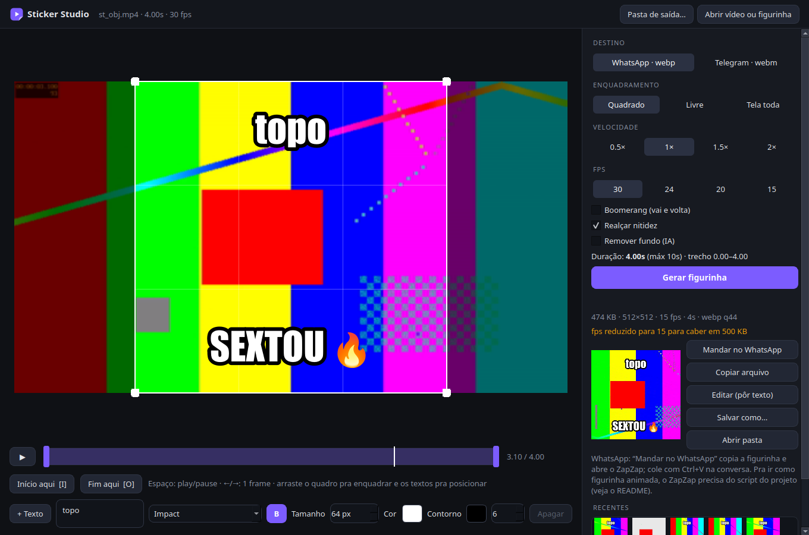

# Sticker Studio

Aplicativo de desktop para criar **figurinhas animadas** de WhatsApp e Telegram a partir de qualquer vídeo, com a melhor qualidade que cabe no limite de cada plataforma. Roda em Linux (AppImage) e Windows (.exe), tudo local, sem enviar nada pra internet.



## O que ele faz

- **Abre qualquer vídeo** que o ffmpeg leia: mp4, mov, mkv, webm, avi, gif, vídeos de celular (inclusive HDR do iPhone, convertido automaticamente para cores normais).
- **Corta o trecho** na linha do tempo, com prévia em loop do jeito que vai ficar.
- **Enquadra** com um quadro arrastável: quadrado, livre ou tela inteira. No WhatsApp, enquadramentos não quadrados ganham bordas transparentes.
- **Velocidade** 0.5×, 1×, 1.5× e 2×, **FPS** (30, 24, 20, 15) e **boomerang** (vai e volta).
- **Texto por cima**, quantas camadas quiser: fonte, negrito, tamanho, cor, contorno (cor e espessura), várias linhas e emoji. Arraste o texto no quadro pra posicionar.
- **Remove o fundo com IA** (BiRefNet), deixando só a pessoa/objeto com fundo transparente. O texto é aplicado depois, então não é apagado junto.
- **Edita figurinhas prontas**: abra um `.webp` ou `.webm` (ou clique em “Editar” no resultado) pra pôr texto por cima, recortar ou trocar a velocidade. A transparência é preservada.
- **Qualidade automática**: testa vários níveis de compressão em paralelo e fica com o melhor que cabe no limite de tamanho. Só reduz o fps se nem a qualidade mínima aceitável couber.
- **Realce de nitidez** opcional, pra compensar a redução para 512 px.
- **Metadados removidos** dos arquivos gerados.
- **Recentes**: miniaturas das últimas figurinhas, com prévia animada, copiar, salvar como e abrir pasta.

### Formatos gerados

| Destino  | Arquivo                 | Tamanho               | Limite de peso | Duração máx. |
|----------|-------------------------|-----------------------|----------------|--------------|
| WhatsApp | `.webp` animado         | 512×512               | 500 KB         | 10 s         |
| Telegram | `.webm` VP9 com alpha   | lado maior 512 px     | 256 KB         | 3 s          |

Figurinha tem teto de 512 px nas duas plataformas, então não existe figurinha “HD”. O que dá pra fazer é aproveitar bem esses 512 px: escala lanczos a partir do vídeo original, realce de nitidez e a maior qualidade que o limite de peso permite. Trechos mais curtos, fundo simples e menos fps sobram mais bytes pra cada frame e deixam a figurinha mais nítida.

## Download

Na página de [Releases](../../releases):

- **Linux**: `StickerStudio-x86_64.AppImage`. Dê permissão de execução (`chmod +x StickerStudio-x86_64.AppImage`) e abra.
- **Windows**: `StickerStudio.exe` (arquivo único) ou `StickerStudio-windows-x64.zip` (pasta portátil, abre mais rápido).

O ffmpeg já vem dentro dos pacotes.

## Como usar

1. **Abrir vídeo ou figurinha** (ou arraste o arquivo pra janela).
2. Escolha o **destino** (WhatsApp ou Telegram).
3. Marque o trecho: arraste as alças roxas da linha do tempo ou use **I** (início) e **O** (fim) no ponto atual.
4. Ajuste o **quadro** arrastando o meio (mover) ou os cantos (redimensionar).
5. Opcional: **+ Texto**, velocidade, fps, boomerang, remover fundo.
6. **Gerar figurinha**. O arquivo vai para `Imagens/Stickers` (dá pra trocar em “Pasta de saída…”).

Atalhos: `Espaço` play/pausa · `←` `→` um frame · `I` início · `O` fim · `Ctrl+O` abrir.

### Telegram

No bot [@Stickers](https://t.me/Stickers), use `/newvideo` (pacote novo) ou `/addsticker` (pacote existente) e envie o `.webm` **como arquivo**.

### WhatsApp

O botão **Mandar no WhatsApp** copia a figurinha pra área de transferência e, no Linux, abre o [ZapZap](https://github.com/rafatosta/zapzap). Basta entrar na conversa e colar com **Ctrl+V**.

O WhatsApp Web (e o ZapZap, que usa o WhatsApp Web) envia `.webp` colado ou arrastado como **imagem estática**, não como figurinha. Pra ir como figurinha animada, instale o script abaixo no ZapZap.

#### Script do ZapZap (figurinha animada)

O arquivo [`zapzap/stickers-animados.js`](zapzap/stickers-animados.js) faz o ZapZap enviar como figurinha qualquer `.webp` colado (Ctrl+V) ou solto numa conversa. Aparece um aviso verde “Figurinha enviada” ou vermelho com o erro. Segure **Shift** ao soltar o arquivo se quiser mandar como imagem comum.

**Pela interface do ZapZap** (recomendado): Configurações → **Customizações avançadas** (*Advanced customizations*) → aba **JavaScript personalizado** (*Custom JavaScript*) → importe o arquivo `stickers-animados.js`, aplique a **todas as contas**, ative e recarregue as páginas (ou reinicie o ZapZap).

**Manualmente** (ZapZap instalado via Flatpak):

```bash
mkdir -p ~/.var/app/com.rtosta.zapzap/data/ZapZap/customizations/global/js
cp zapzap/stickers-animados.js ~/.var/app/com.rtosta.zapzap/data/ZapZap/customizations/global/js/
```

Depois habilite os scripts globais em `~/.var/app/com.rtosta.zapzap/config/ZapZap/ZapZap.conf`, na seção `[custom]` (crie se não existir):

```ini
[custom]
global\js\enabled=true
```

Feche o ZapZap de vez (pela bandeja, porque fechar a janela só minimiza) e abra de novo.

Fora do Flatpak, a pasta de dados fica em `~/.local/share/ZapZap/` e a configuração em `~/.config/ZapZap/ZapZap.conf`.

> O script usa funções internas do WhatsApp Web (o mesmo caminho usado pela biblioteca whatsapp-web.js). Não é uma API oficial: pode parar de funcionar quando o WhatsApp atualizar. Use por sua conta.

## Remoção de fundo (IA)

Na primeira vez que você marcar “Remover fundo”, o app baixa o modelo escolhido para a pasta de dados:

- **Alta qualidade**: BiRefNet general (~930 MB).
- **Rápido**: BiRefNet lite (~220 MB).

A remoção usa a GPU quando o `onnxruntime` instalado oferece aceleração (DirectML no Windows, CUDA no Linux rodando pelo código-fonte com `onnxruntime-gpu`). Sem GPU roda na CPU: funciona, mas leva alguns segundos por frame. Prefira o modelo rápido e trechos curtos nesse caso.

Com GPU NVIDIA no Linux (rodando pelo código-fonte):

```bash
pip install "onnxruntime-gpu[cuda,cudnn]"
```

Se a placa tiver pouca memória para o modelo grande, converta para fp16 (metade da memória, máscara praticamente igual) e salve ao lado do original como `birefnet-general-fp16.onnx`:

```bash
pip install onnx onnxconverter-common
python -c "import onnx; from onnxconverter_common import float16 as f; \
m=onnx.load('birefnet-general.onnx'); onnx.save(f.convert_float_to_float16(m, keep_io_types=True), 'birefnet-general-fp16.onnx')"
```

Pastas de dados: Linux `~/.local/share/StickerStudio/models`, Windows `%LOCALAPPDATA%\StickerStudio\data\models`.

## Rodar pelo código-fonte

Requisitos: Python 3.10+ e ffmpeg no PATH (com `libwebp` e `libvpx`, como nas builds comuns).

```bash
git clone https://github.com/alexonconceicao/sticker-studio.git
cd sticker-studio
python -m venv .venv
source .venv/bin/activate        # Windows: .venv\Scripts\activate
pip install -r requirements.txt
python -m sticker_studio
```

`python -m sticker_studio --selftest` gera uma figurinha de cada tipo sem abrir a janela, pra conferir se está tudo funcionando.

## Gerar os pacotes

```bash
pip install pyinstaller
./packaging/build_linux.sh              # dist/StickerStudio-x86_64.AppImage
```

```powershell
pip install pyinstaller
.\packaging\build_windows.ps1           # dist\StickerStudio.exe e dist\StickerStudio-windows-x64.zip
```

Os scripts baixam o ffmpeg das builds do [BtbN/FFmpeg-Builds](https://github.com/BtbN/FFmpeg-Builds). Ao publicar uma tag `v*`, o GitHub Actions gera os dois pacotes e cria a release.

## Como funciona por dentro

- `sticker_studio/engine/`: motor, sem interface. `media.py` lê vídeos e figurinhas (webp vira um webm sem perdas com alpha pra edição); `render.py` extrai os frames, aplica IA e texto, e faz a busca de qualidade; `background.py` roda o BiRefNet via ONNX.
- `sticker_studio/gui/`: interface Qt (PySide6). A prévia é decodificada pelo próprio ffmpeg e tocada em loop dentro do trecho; o texto é desenhado com o mesmo código na prévia e na exportação.

## Licença

Código em domínio público ([Unlicense](LICENSE)): faça o que quiser com ele.

Os pacotes prontos incluem o [FFmpeg](https://ffmpeg.org) (GPL, código-fonte nas builds do BtbN) e o Qt/PySide6 (LGPL), cada um com a sua licença. Os modelos BiRefNet são baixados do repositório do [rembg](https://github.com/danielgatis/rembg) e seguem as licenças originais.
